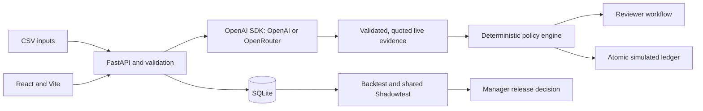

# Refund Operations

By **achopikyan** · Applied AI Engineer home assignment

A local application for two people: the reviewer who resolves refund requests and the operations manager who changes the policy. Payments are simulated; the decision and ledger checks are real application logic.

## Run on Windows or macOS

Install **Python 3.12 or 3.13** and **Node.js 22.12+ or 24 LTS**. The first launch needs internet access to install pinned dependencies. No Docker or database service is needed.

1. Copy `.env.example` to `.env` and add your API key. OpenAI is the default:

   ```dotenv
   OPENAI_API_KEY=your-key
   OPENAI_MODEL=gpt-6.1-sol
   ```

   For OpenRouter instead:

   ```dotenv
   AI_PROVIDER=openrouter
   OPENROUTER_API_KEY=your-key
   OPENROUTER_MODEL=openai/gpt-6.1-sol
   ```

   Both use the official OpenAI Python SDK with the provider's `base_url`. You can also select the provider and enter a session key in the application's Settings. Keys stay on the backend; `.env` is excluded from Git.

2. Run one command from this folder:

   | Windows PowerShell | macOS Terminal |
   | --- | --- |
   | `.\START.cmd` | `sh START.command` |

   The launcher creates a virtual environment, installs dependencies, builds Vite, starts the backend and opens your browser at **http://127.0.0.1:18474**. It selects another port if necessary. Keep the server terminal open; Ctrl+C stops it. Reopening the launcher preserves your database and replaces an outdated server.

3. Choose **Reviewer** or **Refund Operations Manager**. These are local demonstration workspaces, not authentication.

Without a key, the supplied demo can reuse its explicitly identified saved OpenRouter analysis when its full analysis fingerprint matches. You can browse all requests and edit policies. New or edited requests, or an explicitly different provider/model, remain awaiting analysis; no regex-generated facts replace an LLM result. With a key, pending and historical analysis runs through the configured provider, is saved, and resumes after restart. A provider/model or input change requires matching analysis. Every model response is checked for schema, completeness and grounded quotations before use.

## What the history shows

The 248 unique historical requests cover 1 June to 18 August 2026: the old auto rule decided 111 and four reviewers decided 137, recording **1,119 review minutes**. Never-arrived claims took about 450 of those minutes.

- **Money:** 8 approvals were followed by a chargeback: **$2,319 refunded plus $200 in $25 fees**, using the refund as the order amount. Seven were staff approvals made despite contrary evidence already in the notes: signed proof of delivery (RF-1005, RF-2042), a customer confirming delivery (RF-1045) or self-inflicted damage (RF-2083), sealed packaging (RF-1027), or an unconfirmed fraud flag on a new account (RF-2111, RF-1065). The eighth came from the old rule (RF-2074).
- **Inconsistent decisions:** four change-of-mind refunds were approved after the 14-day window that the policy says has no exceptions, and three rejections were overturned on appeal (RF-1008, RF-2090, RF-2143).
- **The old rule ignores notes:** it approved three damage claims of $51–53 without the photo the policy requires above $50 (RF-2037, RF-2046, RF-2121). On today's queue it pays RF-1074, whose note says the store already refunded the customer, and RF-1075, a change of mind on day 22.
- **Messy data:** 3 duplicated rows and one conflicting duplicate (RF-2183); amounts such as `USD 120.00`, `$43`, `55.00 USD` and `$1,150.00`; day-first and ISO-timestamp dates; fraud flags written as `yes`, `Y`, `no`, `N`, `false` or blank; inconsistent reason and category spelling; missing tenure, missing or negative delivery days; and stated reasons that contradict the notes.

## Supplied data and versions

A fresh standard launch copies the clean bundled `data/demo/refundops.sqlite3` into `var/refundops.sqlite3`, with **248 unique historical requests**, **20 unique pending requests**, and their saved live OpenRouter analysis. Existing workspaces are never overwritten. If the supplied source files change, they are imported instead of using the snapshot. The source CSVs contain 251 and 21 rows respectively: exact duplicates are collapsed, while RF-2183 retains its conflicting $49/$52 versions for reconciliation.

- **v1 Current:** reconstructed historical boundary: amount below $55, tenure at least 9 months, no prior refunds, clear payment-risk flag, and a 14-day changed-mind window. It is an ordinary policy, not a special legacy execution mode.
- **v2 Draft:** evidence-aware candidate with explicit business checks, repeat-refund and carrier-incident review, a $300 review ceiling and a $150 cap for photo-supported damage refunds, with customer-damage and no-product-damage exclusions.
- **v3 Draft:** a broader counterexample, including apparel returns up to $300 and repeat requests, plus the wider $300 photo-supported damage rule. It makes the automation/risk tradeoff visible.

Current automatically executes eligible approvals after saved analysis and payment checks. All 20 requests remain visible in **All**; **Open** excludes completed decisions. Initial automatic decisions are produced by the app, not preloaded outcomes.

v1 deliberately starts as Current to reproduce the old system. With the bundled matching analysis, its first launch records **six simulated refunds totalling $233**: RF-1069, RF-1074, RF-1075, RF-2196, RF-2198 and RF-2200. v2 would send the latter five to Review because of previous-refund evidence, a return-window issue or carrier/delivery uncertainty. The comparison separates reconstructing the old boundary from proposing an evidence-aware alternative; the demo never moves real money.

To process another CSV with the same columns, pass it to the same launcher:

| Windows PowerShell | macOS Terminal |
| --- | --- |
| `.\START.cmd --csv path\to\requests.csv` | `sh START.command --csv path/to/requests.csv` |

A new-file run uses **v2 Current** in a separate database keyed by the file's content, without importing the supplied pending queue. Its requests need a configured API key for analysis; without one they remain awaiting analysis. With a key, the 248 historical requests are also analysed once for Backtest, about $1.25 at the measured rate. Repeating the same import does not pay twice. The original source files are never edited.

## Click through the two mechanisms

**Reviewer:** switch between list and review views; inspect request details, all-rule evaluation, quoted LLM evidence, chargeback-risk scenarios and customer history. Correct request fields, reconcile conflicting imports, record staff checks, approve, partially refund, reject, request information, escalate to fraud or hold. Actions require explanations; follow-up outcomes remain separate from predictions. Reviewers never see Shadowtest recommendations.

**Manager:** open v2 or v3. Change settings and rules inline with automatic saving; create a rule manually or from natural language; discover candidates from history and select which to include. Run Backtest, inspect that version's metrics, then start Shadowtest manually. Shadowtest locks editing and observes the same operational requests as Current. Ordinary reviewer decisions supply independent comparison references.

**The brief's two policy changes** are ordinary rules in v2, and a manager can add either to any draft with **Add rule → Describe with AI** or **Build manually**:

- **"From now on, anything over $300 comes to us."** v2 contains `Review amounts above $300` at priority 950, above every other rule. Backtest replays the 248 historical requests before anything goes live: the rule matches 13 requests. Added to reconstructed v1, it changes no route, because the old rule never approved more than $55 automatically.
- **"From now on, stolen-card cases go straight through."** Policy note 5 refunds the real cardholder only after the fraud team confirms, so v2 contains `Confirmed stolen card: full refund` at priority 880. A flagged payment without confirmation always goes to Fraud Review; that check is not configurable. Backtest shows why this matters: a rule on reported fraud matches all 11 historical stolen-card reports, but the required check sends every one to Fraud Review. Confirmation arrives after the decision, so the confirmed-only rule matches none of them in history. Priority decides between the two rules: a confirmed stolen-card refund above $300 still comes to Review.

AI drafting always returns one complete rule and never asks a question. Ambiguous wording gets the most conservative reading, named in the rule, and the manager reviews the proposal before adding it.

**Compare versions** shows v1, v2 and v3 together across decision, evidence/safety, workload/money, segments/rules and cases. **Performance** belongs to each version that has been Current. A candidate can be activated only after its prospective release checks pass. Existing backlog can demonstrate Shadowtest but cannot qualify a release; Current cannot enter Shadowtest. Previously active versions have an explicit rollback preview that preserves decisions, payments and spent limits.

## Architecture



The LLM extracts predefined facts from allowlisted request-time fields and both notes, and can draft a typed rule for review. Future decisions, outcomes, reviewer labels and other-policy predictions never enter the extraction input. Citations, field types and permitted sources are checked. Normalization and injection tripwires remain deterministic; they do not fabricate semantic evidence. Finite tests cannot prove universal injection resistance.

Python controls rule priority, all-rule matching, routes, amount bounds, eligibility, version locking and payments. SQLite transactions enforce idempotency and single-payment, daily, customer and release limits. Discovery enumerates interpretable rule hypotheses; it does not ask an LLM to invent financial performance.

## Evidence, evaluation and limitations

The measured OpenRouter run used **openai/gpt-6.1-sol**: **20/20 pending acceptance cases**, **248/248 complete historical analyses**, and 268 successful analysis calls averaging **$0.0047**, with **7.3 seconds median latency**. These are recorded observations, not price promises or a factual-accuracy estimate.

Direct OpenAI was also verified with a real project key through the same official SDK and application extractor: **20 successful calls for all 20 pending requests**, using **gpt-6.1-sol**. Every response assessed all 21 predefined questions and passed schema, source and quotation validation. v2 matched the development routing references on 20/20 cases: 2 Auto Approve, 16 Review and 2 Fraud Review. The run took 41 seconds with up to three concurrent requests; median call latency was 5.3 seconds and total usage was 40,557 tokens. The API did not report a dollar cost. These are development cases, not an unseen accuracy benchmark; the 248 historical requests were not rerun through OpenAI.

An earlier development run with gpt-5.4-mini passed 14/20 pending cases; the subsequent Sol run passed 20/20. Prompts also changed, so this is not a controlled model comparison. A former regex warning baseline matched 16/17 labelled facts but was removed: operational evidence now requires a live LLM response.

The same 248-case replay gives the following **proposals**, not payments or proven losses:

| Version | Auto / 248 | Proposed refunds | Human refs / auto | Assessed excess | Known chargebacks on auto |
| --- | ---: | ---: | ---: | ---: | ---: |
| v1 | 108 | $3,332.51 | 1 / 108 | $0 | 1 |
| v2 | 108 | $4,430 | 32 / 108 | $0 | 0 |
| v3 | 125 | $6,681.45 | 44 / 125 | $415 (3 cases) | 0 |

Assessed excess means dollars above historical human decision amounts. Those decisions can be wrong, 214 outcomes are unknown, and proposals outside the reference counts lack an independent human assessment. Zero observed excess is not proof of safety.

v2 changes selection rather than increasing the automatic count: 31 requests become automatic and 31 return to Review compared with reconstructed v1. It proposes automation for 32 historically staff-handled cases with 147 recorded review minutes. Of these, the 31 newly automatic cases contain 144 minutes; the returned cases have no recorded manual duration. Assuming eight minutes each adds 248 minutes, a scenario of **104 extra review minutes**, not savings. The interface keeps observed minutes separate from assumptions.

v2 removes the inherited nine-month tenure cutoff from simple returns as an explicit hypothesis, relying on amount limits, no prior refunds and evidence checks instead. Account tenure remains visible in comparisons; the small sample does not prove that removing this cutoff is safe. Pending was inspected during development and is not a blind holdout. No causal savings or calibrated chargeback probabilities are claimed.

The interface exposes denominators, missing evidence, amount disagreements, recorded adverse outcomes and financial scenarios. The manager owns tolerances and the final tradeoff. The LLM spending setting is a **soft reported-cost threshold**, not a hard billing cap; concurrent calls can overshoot and OpenAI may report tokens without a dollar cost. Use provider account limits for billing control.

Recorded chargebacks also vary across historical cohorts of approved or partial refunds, excluding one row with invalid data:

| Refunded cohort | Known chargebacks / refunds |
| --- | ---: |
| Requested amount at most $50 | 1 / 130 |
| Requested amount over $100 through $200 | 2 / 23 |
| Requested amount over $300 | 4 / 12 |
| Customer tenure at least 24 months | 0 / 95 |

These are counts of recorded outcomes, not calibrated risk rates: 214 of the 248 requests have no recorded outcome. Small groups and incomplete follow-up prevent a causal claim about an amount or tenure cutoff.

Historical model-call measurements are retained in the demo database as `demo_llm_calls`; a fresh workspace starts its own reported-cost counter at zero. A different provider or model needs its own extraction, while the existing recorded evidence remains inspectable.

The [editable PowerPoint write-up](deliverables/write-up.pptx) is the primary presentation; a [searchable PDF viewing copy](deliverables/write-up.pdf) is also included. Two supporting documents go deeper: the [data analysis](deliverables/data-analysis.pdf) of the supplied CSVs, and [supplementary slides](deliverables/supplementary-slides.pdf) on the three policy versions and their shared evaluation path. Watch the [workflow demo](deliverables/demo.mp4) for both roles and the policy lifecycle. Backtest and comparison reports can be exported from the interface; the bundled demo database contains the recorded live extraction.

## Verify

```sh
python run.py --check
npm ci --prefix scripts/e2e
npm exec --prefix scripts/e2e -- playwright install chromium
node scripts/e2e/runner.cjs ../decision-evidence-e2e.cjs
node scripts/e2e/runner.cjs ../policy-release-e2e.cjs
node scripts/e2e/runner.cjs ../reviewer-forms-e2e.cjs
```

Tests use isolated databases and mocked model responses; they never change the operational queue. Windows launch was verified. macOS launch was verified from a fresh clone with `sh START.command`, including the bundled no-key demo. The `--csv` path was checked end to end with a new six-request file and a live OpenAI key: three automatic refunds (wrong size, photo-supported damage, confirmed stolen card) and three Review routes (delivery proof, return window, amount above $300).

## Scope and AI coding tools

AI coding assistants helped scaffold components, tests and documentation. I replaced a generated hidden fallback approval rule with visible policy rules and checks, removed regex-based semantic extraction, and separated historical observations from correctness labels. The submitted design and decisions are my responsibility.

The demonstration substitutes four external capabilities:

- **Payments:** approvals write to a simulated SQLite ledger; no payment provider is called.
- **Identity:** a local workspace switch selects the reviewer or manager; it is not authentication.
- **Customer messages:** replies are editable templates; nothing is sent.
- **External verification:** photo, carrier and order evidence comes from supplied notes or staff entries. The app does not inspect image files or query external carrier/order systems.

Live LLM extraction, deterministic policy evaluation, saved versions, Backtest, Shadowtest and ledger invariants are implemented application behavior. Automated tests use explicit model fixtures; the reported provider runs used real calls.

Excluded as requested: authentication, cloud deployment and real payment integration. Also deferred: independently labelled unseen evaluation, calibrated chargeback prediction, a distributed worker queue and production security/operations. `archive/` contains retired local work and is excluded from Git.
